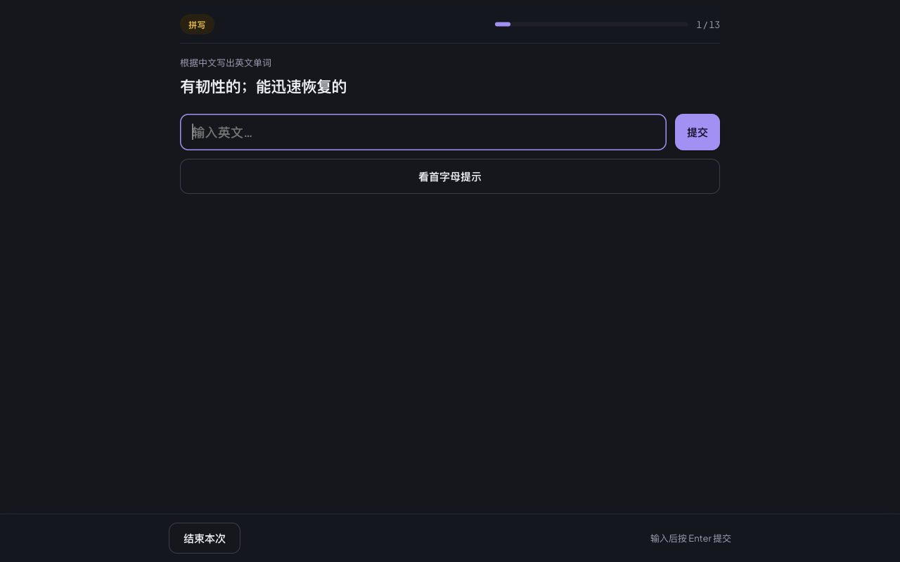
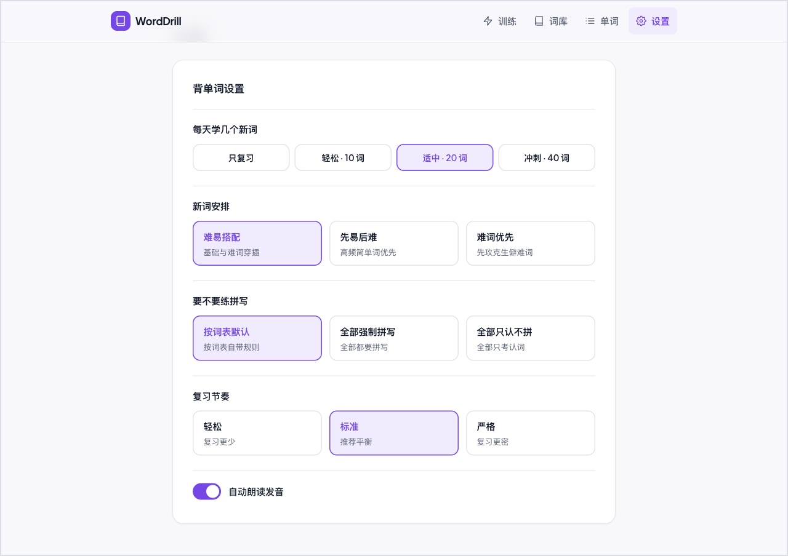
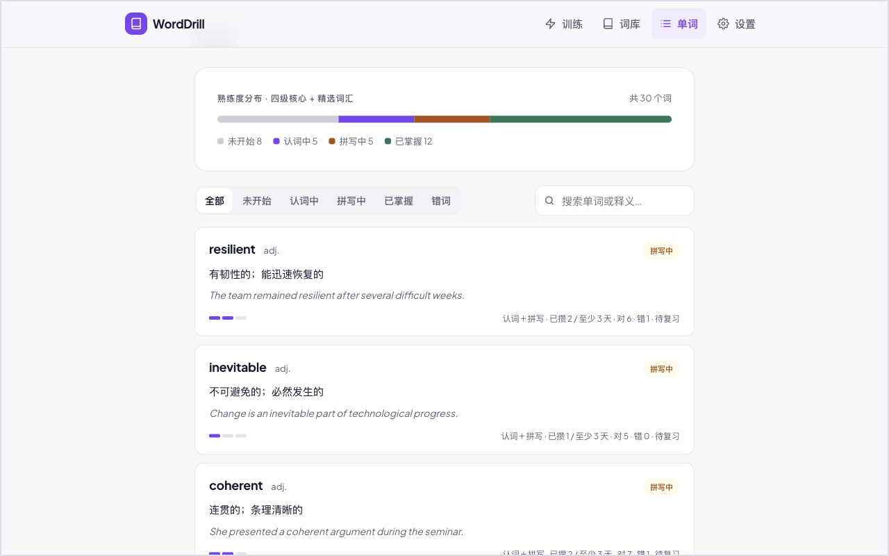
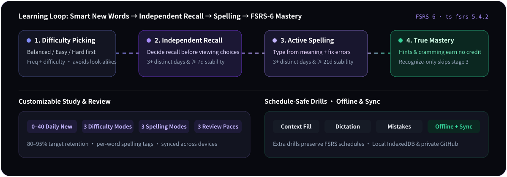

<p align="right">
  <a href="README.md">简体中文</a> · <strong>English</strong>
</p>

<p align="center">
  
</p>

<p align="center">
  
  
  
</p>

<p align="center">
  <a href="https://drivinggodj.github.io/word-drill/"><strong>Start Training Online</strong></a> ·
  <a href="docs/GUIDE.en.md">User Guide</a> ·
  <a href="docs/learning-upgrade.md">Learning Rationale (Chinese)</a> ·
  <a href="skills/worddrill-assistant/SKILL.md">Agent Skill</a>
</p>

> **A vocabulary trainer engineered to help you actually remember and spell words.** Built against passive multiple-choice illusions, WordDrill combines **independent recall checks**, **separate recognition & spelling stages**, **FSRS-6 cross-day promotion**, and **difficulty-aware daily word selection**.

---

## Interface Showcase

<table>
  <tr>
    <td width="68%" align="center" valign="middle">
      <picture>
        <source media="(prefers-color-scheme: dark)" srcset="docs/assets/screenshot-home-dark.png" />
        <source media="(prefers-color-scheme: light)" srcset="docs/assets/screenshot-home-light.png" />
        
      </picture>
      <br />
      <sub><b>Daily Training Home</b>: Clear due reviews, new-word quota, and mastered count with automatic light/dark adaptation</sub>
    </td>
    <td width="32%" align="center" valign="middle">
      
      <br />
      <sub><b>Study Anywhere</b>: Installable offline PWA tailored for one-handed mobile practice</sub>
    </td>
  </tr>
</table>

---

## Why WordDrill Helps Words Stick

<table>
  <tr>
    <td width="50%" valign="top">
      <h3>💭 Independent Recall Before Multiple Choice</h3>
      <p>Recognition prompts you to decide whether you <strong>truly recalled the meaning</strong> before options appear—eliminating passive guessing.</p>
      <p>Answering with option hints or first-letter cues schedules a retry and <strong>never earns promotion credit</strong>.</p>
    </td>
    <td width="50%" valign="top">
      <h3>🧠 FSRS-6 Spacing &amp; Cross-Day Promotion</h3>
      <p>Powered by bundled <code>ts-fsrs 5.4.2</code>, formal sessions prioritize due reviews. Words advance strictly through <strong>Unseen → Recognition → Spelling → Mastered</strong>.</p>
      <p>Promotion demands independent recall on <strong>3+ distinct days</strong> plus <strong>7-day</strong> recognition and <strong>21-day</strong> spelling stability—no same-day cramming shortcuts.</p>
    </td>
  </tr>
  <tr>
    <td width="50%" valign="top">
      <h3>📊 Difficulty-Aware Daily New Word Selection</h3>
      <p>Estimates word difficulty (0–100) from frequency rank, deck difficulty tags, and word shape, while spacing out words that share the same 3-letter prefix to prevent confusion.</p>
      <p>Choose from three <strong>New Word Ordering</strong> modes: <strong>Balanced</strong> (40% easy / 40% medium / 20% hard interleaved), <strong>Easy First</strong> (high-frequency basics first), or <strong>Hard First</strong> (tackle tough words first).</p>
    </td>
    <td width="50%" valign="top">
      <h3>🎛️ Fully Customizable Study &amp; Review Pacing</h3>
      <p>Tune <strong>daily new-word quota</strong> (0 / 10 / 20 / 40), <strong>three spelling modes</strong> (Deck Default / Force All Spelling / Recognize-Only), and <strong>three review paces</strong> (Light / Standard / Strict, 80–95% retention).</p>
      <p>Supports per-word <code>拼写</code> / <code>只认</code> tags, with all learning settings synced across devices.</p>
    </td>
  </tr>
  <tr>
    <td width="50%" valign="top">
      <h3>🎧 Schedule-Safe Extra Drills</h3>
      <p>Practice anytime with <strong>Review Only</strong>, <strong>Mistake Consolidation</strong>, <strong>Free Practice</strong>, full-sentence <strong>Context Fill</strong>, and speech-driven <strong>Dictation</strong>—all preserving formal FSRS schedules.</p>
    </td>
    <td width="50%" valign="top">
      <h3>📚 Offline-First PWA &amp; Community Wordlists</h3>
      <p>Pull and merge CET-4, CET-6, and IELTS decks offline from the <a href="https://github.com/DrivingGodJ/worddrill-wordlists">Public Wordlists Repo</a>, or open a PR to contribute new decks. Optional private GitHub sync and the bundled <a href="skills/worddrill-assistant/SKILL.md">Agent Skill</a> keep multi-device progress safe.</p>
    </td>
  </tr>
</table>

---

## Core Learning Screens

<table>
  <tr>
    <td width="50%" align="center" valign="top">
      
      <br />
      <sub><b>Independent Recall Gate</b>: Confirm silent recall first before verifying against options</sub>
    </td>
    <td width="50%" align="center" valign="top">
      
      <br />
      <sub><b>Active Spelling Stage</b>: Type English from meaning with hints hidden and mandatory mistake correction</sub>
    </td>
  </tr>
  <tr>
    <td width="50%" align="center" valign="top">
      
      <br />
      <sub><b>Custom Pacing &amp; Difficulty</b>: Daily quota, Balanced / Easy-First / Hard-First ordering, spelling rules, and review pace</sub>
    </td>
    <td width="50%" align="center" valign="top">
      
      <br />
      <sub><b>Memory Stability Inspector</b>: 4-stage mastery bar, per-word tags, FSRS stability days, and upcoming due dates</sub>
    </td>
  </tr>
</table>

---

## Learning Algorithm & Loop

<p align="center">
  
</p>

> [!TIP]
> **Privacy & Offline First**: The public website hosts zero personal data or trackers. Optional GitHub tokens stay strictly in your browser's local storage and talk only to GitHub's API for your private repository.

---

## Quick Start in 3 Steps

1. **Open**: Visit [drivinggodj.github.io/word-drill](https://drivinggodj.github.io/word-drill/) and optionally add it to your mobile home screen.
2. **Add a Wordbook**: In **Wordbooks**, pull CET-4 / CET-6 / IELTS decks from [worddrill-wordlists](https://github.com/DrivingGodJ/worddrill-wordlists) (multi-select merge supported), import a JSON backup, or bind your private GitHub repository.
3. **Customize & Train**: Pick your daily quota, difficulty ordering, and spelling preference in **Settings**, then start your session.

> [!NOTE]
> **Contribute New Wordlists**: Want to share TOEFL, GRE, Postgraduate, or domain-specific decks with other learners? Visit [DrivingGodJ/worddrill-wordlists](https://github.com/DrivingGodJ/worddrill-wordlists) and follow the [Authoring & Contribution Guide](https://github.com/DrivingGodJ/worddrill-wordlists/blob/main/docs/GUIDE.en.md) to submit a Pull Request.

<details>
<summary>Local Algorithm &amp; Deck Verification Commands</summary>

```bash
# Run FSRS-6 scheduling, promotion, and difficulty-ordering tests (Node.js 20+, zero deps)
node scripts/check-learning.cjs

# Validate CET deck rules (Python 3)
python3 scripts/check-cet.py

# Dry-run adding custom words to a local clone of your private data repo
python3 scripts/add-words.py --repo /path/to/data-repo --json-file batch.json --dry-run
```

</details>

---

## Documentation & License

| Topic | Documentation |
| :--- | :--- |
| Training rules, multi-device sync, and progress safety | [User Guide](docs/GUIDE.en.md) |
| Memory research and rule rationale | [Learning Logic (Chinese)](docs/learning-upgrade.md) |
| Sync, daily preparation, and migration reference | [Full Reference (Chinese)](docs/readme-reference.zh-CN.md) |
| Private repo setup and safe word import | [worddrill-assistant Skill](skills/worddrill-assistant/SKILL.md) |
| Promo video plan (4K 60fps 16:9 & 9:16) | [Promo Video Plan (Chinese)](docs/promo-video-plan.md) |
| Public standard decks &amp; PR guide for contributing wordlists | [worddrill-wordlists Repository](https://github.com/DrivingGodJ/worddrill-wordlists) |
| Feedback and bug reports | [GitHub Issues](https://github.com/DrivingGodJ/word-drill/issues) |

**License & Credits**: No standalone repository-wide license is declared. Bundled `ts-fsrs 5.4.2` in `vendor/` retains its MIT license; dictionaries, frequency lists, and example sentences retain their respective source terms. See [User Guide · License and Credits](docs/GUIDE.en.md#license-and-credits).
