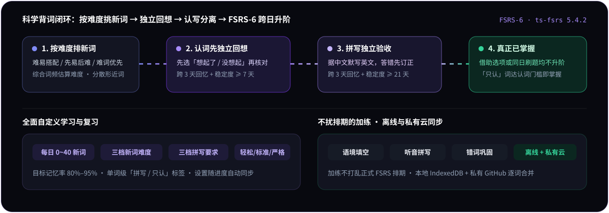

<p align="right">
  <strong>简体中文</strong> · <a href="README.en.md">English</a>
</p>

<p align="center">
  
</p>

<p align="center">
  
  
  
</p>

<p align="center">
  <a href="https://drivinggodj.github.io/word-drill/"><strong>在线开始背单词</strong></a> ·
  <a href="docs/GUIDE.zh-CN.md">使用与配置指南</a> ·
  <a href="docs/learning-upgrade.md">记忆算法与研究依据</a> ·
  <a href="skills/worddrill-assistant/SKILL.md">Agent 助手 Skill</a>
</p>

> **一款真正帮你记住并写出来的背单词软件。** 针对“刷选项以为会了、合上书就忘、提笔写不出”的痛点，WordDrill 把**主动独立回想**、**认写分离**、**FSRS-6 跨日升阶算法**与**按难度智能排词**融为一套极简高效的日常训练流程。

---

## 界面一览

<table>
  <tr>
    <td width="68%" align="center" valign="middle">
      <picture>
        <source media="(prefers-color-scheme: dark)" srcset="docs/assets/screenshot-home-dark.png" />
        <source media="(prefers-color-scheme: light)" srcset="docs/assets/screenshot-home-light.png" />
        
      </picture>
      <br />
      <sub><b>今日训练主页</b>：一眼看清待复习、新词配额与已掌握进度，跟随系统自动切换深浅色</sub>
    </td>
    <td width="32%" align="center" valign="middle">
      
      <br />
      <sub><b>手机端随时背</b>：添加到主屏幕离线可用，单手流畅操作</sub>
    </td>
  </tr>
</table>

---

## 为什么 WordDrill 能帮你背得更牢

<table>
  <tr>
    <td width="50%" valign="top">
      <h3>💭 先问“能否独立想起”，告别看选项蒙对</h3>
      <p>认词题不会一上来就把四个中文选项摊在眼前，而是先让你判断<strong>「想起了，核对选项」</strong>还是<strong>「没想起，借助选项」</strong>。</p>
      <p>借助选项或看提示后答对，系统只会安排再次复习、<strong>绝不计入升阶天数</strong>，逼出真正的主动记忆提取。</p>
    </td>
    <td width="50%" valign="top">
      <h3>🧠 FSRS-6 科学复习 + 跨日升阶算法</h3>
      <p>内置 <code>ts-fsrs 5.4.2</code>，正式训练优先安排到期复习。单词严格经历 <strong>未开始 → 认词中 → 拼写中 → 已掌握</strong>。</p>
      <p>升阶需要<strong>跨 3 个不同日子</strong>的独立正确回忆，并达到认词 <strong>7 天</strong> / 拼写 <strong>21 天</strong>稳定性门槛，同一天刷题无法刷出“假掌握”。</p>
    </td>
  </tr>
  <tr>
    <td width="50%" valign="top">
      <h3>📊 按词频与难度智能安排每日新词</h3>
      <p>综合词频、词库难度分级与词形特征估算单词难度（0–100），并自动分散前 3 字母相近的形近易混词。</p>
      <p>支持三档<strong>新词安排</strong>模式：<strong>难易搭配</strong>（默认按基础/中等/进阶 40% / 40% / 20% 穿插）、<strong>先易后难</strong>（高频简单词优先）与<strong>难词优先</strong>（考前集中攻克生词）。</p>
    </td>
    <td width="50%" valign="top">
      <h3>🎛️ 学习量、拼写与复习节奏全面自定义</h3>
      <p>自由定制<strong>每日新词量</strong>（只复习 / 10 / 20 / 40 词）、<strong>三档拼写要求</strong>（按词表默认 / 全部强制拼写 / 全部只认不拼）与<strong>三档复习节奏</strong>（轻松 / 标准 / 严格，目标记忆率 80%–95%）。</p>
      <p>支持单词级 <code>拼写</code> / <code>只认</code> 标签，所有学习参数随进度跨设备同步。</p>
    </td>
  </tr>
  <tr>
    <td width="50%" valign="top">
      <h3>🎧 多维独立加练，不打乱正式排期</h3>
      <p>除正式训练外，随时可进入<strong>只复习</strong>、<strong>错词巩固</strong>、<strong>自由加练</strong>、完整例句<strong>语境填空</strong>与设备朗读<strong>听音拼写</strong>，完整保留原有 FSRS 复习间隔。</p>
    </td>
    <td width="50%" valign="top">
      <h3>📚 离线优先 PWA + 公开词表共建</h3>
      <p>本地词库基于 IndexedDB 离线可用，可从 <a href="https://github.com/DrivingGodJ/worddrill-wordlists">公开单词表仓库</a> 拉取合并四级/六级/雅思词表，也欢迎提交 PR 贡献考研、托福、专业英语等新词表；同时支持私有 GitHub 逐词同步与 <a href="skills/worddrill-assistant/SKILL.md">Agent Skill</a> 建库加词。</p>
    </td>
  </tr>
</table>

---

## 核心学习界面实拍

<table>
  <tr>
    <td width="50%" align="center" valign="top">
      
      <br />
      <sub><b>独立回想确认</b>：先诚实选择能否独立想起，再展开选项核对</sub>
    </td>
    <td width="50%" align="center" valign="top">
      
      <br />
      <sub><b>拼写独立验收</b>：根据中文写出英文，隐藏首字母提示，错后先订正</sub>
    </td>
  </tr>
  <tr>
    <td width="50%" align="center" valign="top">
      
      <br />
      <sub><b>自定义学习与复习</b>：新词量、难易搭配/先易后难/难词优先、三档拼写与复习节奏一页直选</sub>
    </td>
    <td width="50%" align="center" valign="top">
      
      <br />
      <sub><b>记忆稳定性追踪</b>：四阶段熟练度分布条、<code>拼写</code>/<code>只认</code> 标签、FSRS 稳定性天数与下次复习时间</sub>
    </td>
  </tr>
</table>

---

## 算法与学习闭环

<p align="center">
  
</p>

> [!TIP]
> **软件与词库彻底分离**：公开站点零追踪、不收集个人学习记录；细粒度 GitHub Token 仅保存在当前浏览器本地，只与你自己的私有仓库通信。

---

## 3 步开始背单词

1. **打开应用**：访问 [drivinggodj.github.io/word-drill](https://drivinggodj.github.io/word-drill/)，推荐在手机浏览器中“添加到主屏幕”。
2. **添加词库**：在「**词库**」页从 [公开单词表仓库](https://github.com/DrivingGodJ/worddrill-wordlists) 一键拉取四级 / 六级 / 雅思词表（支持多选合并），或导入 JSON / 连接私有 GitHub 数据仓库。
3. **定制节奏并开练**：在「**设置**」页选好每日新词量、新词难度安排与拼写要求，回到「**训练**」点击“**开始训练**”。

> [!NOTE]
> **欢迎提交新单词表**：想让更多人直接拉取考研、托福、GRE 或专业领域词表？前往 [DrivingGodJ/worddrill-wordlists](https://github.com/DrivingGodJ/worddrill-wordlists) 查看 [词表构建与提交指南](https://github.com/DrivingGodJ/worddrill-wordlists/blob/main/docs/GUIDE.zh-CN.md)，按规范准备 JSON 并提交 Pull Request 即可。

<details>
<summary>本地校验学习算法与词库脚本</summary>

```bash
# 运行 FSRS-6 调度、升阶与新词难度挑选测试（Node.js 20+，零依赖）
node scripts/check-learning.cjs

# 校验词库规则（Python 3）
python3 scripts/check-cet.py

# 向本地私有数据仓库安全预演加词
python3 scripts/add-words.py --repo /path/to/data-repo --json-file batch.json --dry-run
```

</details>

---

## 文档导航与许可

| 主题 | 文档入口 |
| :--- | :--- |
| 训练方式、学习规则与进度保护 | [使用与配置指南](docs/GUIDE.zh-CN.md) |
| 记忆研究依据、考试要求与规则边界 | [学习逻辑说明](docs/learning-upgrade.md) |
| 多设备同步、每日备词与迁移参考 | [完整参考文档](docs/readme-reference.zh-CN.md) |
| 私有建库与安全加词自动化 | [worddrill-assistant Skill](skills/worddrill-assistant/SKILL.md) |
| 宣传视频策划方案（4K 60fps 16:9 & 9:16） | [视频分镜与制作方案](docs/promo-video-plan.md) |
| 公开标准词表与 PR 提交新词表规范 | [worddrill-wordlists 词表仓库](https://github.com/DrivingGodJ/worddrill-wordlists) |
| 问题反馈与建议 | [GitHub Issues](https://github.com/DrivingGodJ/word-drill/issues) |

**许可与致谢**：本仓库未声明独立的整仓开源许可证；`vendor/` 中内置的 `ts-fsrs 5.4.2` 保留其 MIT 许可，词书、词频与例句资料各自遵循原始来源约定，详见 [使用指南 · 许可与致谢](docs/GUIDE.zh-CN.md#许可与致谢)。
